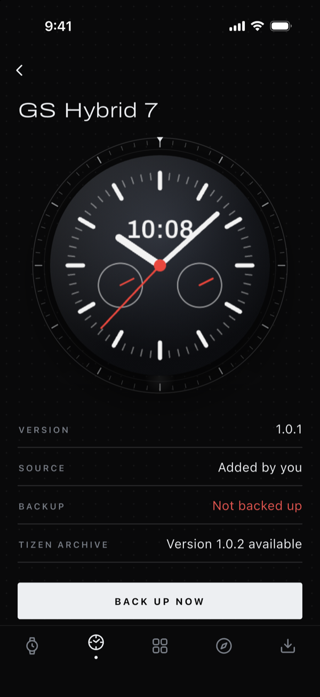

<p align="center">
  
</p>

<h1 align="center">Galaxy Wristore</h1>

<p align="center">
  Install, back up and restore the faces and apps on a Samsung Tizen watch, from your phone, over Wi-Fi.
</p>

<p align="center">
  <a href="https://github.com/Arik39/galaxy-wristore/releases/latest"></a>
  <a href="https://github.com/Arik39/galaxy-wristore/releases"></a>
  <a href="https://github.com/Arik39/galaxy-wristore/actions/workflows/ci.yml"></a>
  <a href="LICENSE"></a>
</p>

<p align="center">
  <a href="https://github.com/Arik39/galaxy-wristore/releases/latest/download/galaxy-wristore.apk"><b>Download for Android</b></a>
  &nbsp;·&nbsp;
  <a href="#iphone">iPhone</a>
  &nbsp;·&nbsp;
  <a href="#how-to-use-it">How to use it</a>
  &nbsp;·&nbsp;
  <a href="CONTRIBUTING.md">Contribute</a>
</p>

<p align="center">
  
  
  
  
</p>

**For Tizen and Galaxy Watch.** Samsung stopped Tizen downloads on 30 September 2025, so the Galaxy Store can no
longer give back a face or an app once a watch is reset. Galaxy Wristore replaces the parts of Samsung's watch app that
went with it. It works with an iPhone or an Android phone.

It talks to the watch directly over its Wi-Fi debugging link (`sdb`), so it needs neither Galaxy Wearable nor an
Android phone.

## Features

- **Discover** uses [Tizen Archive](https://tizen-archive.com) in place of the Galaxy Store. Search faces and apps,
  look at the pictures inside a package, and install in one tap. Every download is checked against the archive's
  SHA-256 and size before it reaches the watch.
- **Backup** replaces Samsung account backup. One `.twbackup` file holds copies of the faces and apps you added, the
  music and pictures on the watch, and a fingerprint of every app. The app tells you plainly what a reset would
  remove for good.

  **It can bring back only the faces and apps that Tizen Archive has.** An installed app cannot be copied off the
  watch, so one the archive does not have is not in your backup, and a reset removes it for good.
- **Restore** puts back only what you pick, item by item, with each face's pictures full size.
- **Faces and Apps** show what is on the watch with its real pictures, mark what is not backed up, offer updates
  from Tizen Archive, and remove what you added.
- **Install a file you have:** open a `.tpk` or `.wgt` from Discover. The app shows what it is and whether its
  signature looks store-signed. The watch has the last word on what it accepts.
- **Your backups travel:** save or share a backup file, add one back on another phone, and open backups made by the
  [Tizen Companion Installer](https://github.com/Tizen-Archive/tizen-companion-installer) Mac app.
- **Private by design:** no account, ads, analytics or trackers.

<p align="center">
  
  
  
  
</p>

<p align="center"><sub>Screenshots from the app's built-in demo watch.</sub></p>

## Download and install

### Android

Android 7.0 or later.

1. On your phone, download
   **[galaxy-wristore.apk](https://github.com/Arik39/galaxy-wristore/releases/latest/download/galaxy-wristore.apk)**
   from the [latest release](https://github.com/Arik39/galaxy-wristore/releases/latest).
2. Open the downloaded file, from the notification or from **Files → Downloads**.
3. If Android asks, allow your browser or Files app to install unknown apps: tap **Settings**, turn on **Allow from
   this source**, then go back.
4. Tap **Install**. If Google Play Protect says it does not recognise the app, tap **More details**, then **Install
   anyway**. The app is not on Google Play, so Play Protect has not seen it before.
5. Open **Wristore** from your app drawer, then [set up the watch](#set-up-the-watch).

**Updating:** download the new APK from the latest release and install it over the old one. Your backups stay.
To hear about new versions, choose **Watch → Custom → Releases** at the top of this page on GitHub.

<details>
<summary>Check that a download is genuine</summary>

Each release has a `galaxy-wristore.apk.sha256` file next to the APK:

```sh
sha256sum -c galaxy-wristore.apk.sha256        # Linux
shasum -a 256 -c galaxy-wristore.apk.sha256    # macOS
```

Every release is signed with the same key. Its certificate's SHA-256 fingerprint is:

```
92:BC:5A:C5:B2:27:72:81:6A:FD:87:65:F1:FA:5E:78:A1:8A:6E:CC:5D:43:CE:D5:36:1E:78:AB:FD:EE:68:F0
```

Compare it with `apksigner verify --print-certs galaxy-wristore.apk` from the Android SDK, or with an app such as
AppVerifier.

</details>

### iPhone

There is no App Store version yet, so you build it yourself on a Mac:

1. Install [Flutter](https://docs.flutter.dev/get-started/install) (3.47 or later) and Xcode.
2. Get the code and its packages:

   ```sh
   git clone https://github.com/Arik39/galaxy-wristore.git
   cd galaxy-wristore
   flutter pub get
   ```

3. Open `ios/Runner.xcworkspace` in Xcode. Under **Signing & Capabilities**, choose your Personal Team.
4. Connect your iPhone, select it as the run destination, and press **Run**.

Without a paid Apple Developer account, a personal build must be re-installed every 7 days. iOS asks for **Local
Network** access the first time the app looks for the watch; the app needs it.

## Set up the watch

You do this once per watch.

1. On the watch, open **Settings → About watch → Software**, then tap **Software version** five times.
2. Back in **About watch**, turn on **Debugging**.
3. Restart the watch. Debugging starts answering only after a restart.
4. Keep the watch on the same Wi-Fi as the phone (not a guest network). The first time the app connects, the watch
   asks **Allow debugging**: tap the check mark.

The watch serves one device at a time. Close other tools that connect to it, such as the Mac app or `sdb`, before
using the phone.

## How to use it

The app has five tabs along the bottom: **Watch**, **Faces**, **Apps**, **Discover** and **Backup**.

### Connect your watch

1. Wake the watch and keep it awake: tap its screen now and then.
2. On the **Watch** tab, tap **Connect my watch**. The app looks for the watch on your Wi-Fi.
3. Tap your watch in the list. On the watch, tap the check mark to allow this phone.

If the watch is not found, tap **Type its address** and enter its IP address. The watch shows it under **Settings →
Connections → Wi-Fi**, then your network.

Once connected, the **Watch** tab shows the face on your wrist, the battery and how much of the watch is backed up.
The app remembers the watch and reconnects next time.

### Find and install faces and apps

1. Open **Discover**. Switch between **Faces** and **Apps**, or search Tizen Archive by name.
2. Tap a face or app to see its details. **See its pictures** shows the pictures inside the package.
3. Tap **Install on my watch**. The app downloads the package, checks it, and installs it on the watch.

### Install a file you have

1. On **Discover**, tap the file icon at the top right.
2. Choose a `.tpk` or `.wgt` file.
3. The app shows its name, version and whether it looks store-signed. Tap **Install on my watch**.

The watch accepts only packages signed for the store, so a rebuilt or changed face is likely to be refused.

### Back up your watch

1. Open **Backup** and tap **Back up now**. The **Watch** tab's button does the same.
2. Keep the watch awake until the backup finishes.

**Backup** lists what is not in your latest backup yet. On **Faces** and **Apps**, a red dot or **Not backed up**
marks the same. Under **Your backups**, tap a backup to restore from it, or tap the arrow beside it for its menu:

- **Restore from it** puts things back on the watch.
- **Save or share the file** keeps a copy elsewhere: Files, a cloud drive or another phone. Do this before you reset
  the watch or change phones.
- **Delete** removes it from this phone. Copies you saved elsewhere stay.

To use a backup file from elsewhere, tap the file icon at the top right of **Backup** and choose the `.twbackup` file.

### Restore after a reset

1. Set up the watch and connect it again (see above).
2. On **Backup**, tap the backup to restore from.
3. Tick the faces, apps and files to put back, or tap **All**. Tap a face's picture to see it full size.
4. Tap **Put back** and keep the watch awake until it finishes.

### Keep the watch tidy

Open a face on **Faces**, or an app on **Apps**, to see its version, where it came from and whether it is backed up.
From there you can:

- **Update** it when Tizen Archive has a newer version.
- **Back it up** if it is not in a backup yet.
- **Remove it from the watch.** Only faces and apps you added can be removed; the ones that came with the watch stay.

## Troubleshooting

- **No watch answered.** Wake the watch, check that **Debugging** is on and that the watch and phone use the same
  Wi-Fi, then look again. Restart the watch if you have just turned **Debugging** on. Guest networks and some mesh or
  office networks keep devices apart; type the address instead.
- **Another device is connected to it.** Close the other tool that uses the watch (`sdb`, Tizen Studio or the Mac
  app), or restart the watch.
- **The watch never asks to allow this phone.** Wake it and look again; the question shows on the watch screen
  only while it is on.
- **iPhone finds nothing.** Allow Local Network access: **Settings → Privacy & Security → Local Network →
  Wristore**.
- **The watch refused a package.** The watch installs only store-signed packages, and some are made for specific
  watch models.

## What it cannot do

These run over Samsung's Bluetooth protocols, which other apps cannot use, so they stay with Samsung's app:
pairing, notifications from the phone, health sync and software updates.

Some limits come from the watch itself:

- It installs only packages signed for the store. Samsung no longer issues developer certificates, so a face that
  was rebuilt or changed cannot be installed.
- Installed packages cannot be copied off a watch. A backup keeps a copy only of what Tizen Archive has, or of
  package files you add yourself.
- The data inside watch apps, health data included, cannot be read.

## Privacy

There are no ads, analytics or trackers. The app connects only to Tizen Archive and to your watch on your own
network. Backups stay on your phone until you share them.

## Build from source

The app is written in Flutter (3.47 or later).

```sh
git clone https://github.com/Arik39/galaxy-wristore.git
cd galaxy-wristore
flutter pub get
flutter run                                   # on a connected phone
flutter run --dart-define=WRISTORE_DEMO=true  # with a built-in demo watch, no watch needed
flutter test
```

- **Android:** `flutter build apk --release` builds an APK to install directly. Without a release key it is signed
  with your debug key, so it cannot update an APK from the releases page; uninstall that one first.
- **iPhone:** see [iPhone](#iphone) above.

## Contributing

Galaxy Wristore is open source, and help is welcome: bug reports, testing with different watch models, fixes and
features. [CONTRIBUTING.md](CONTRIBUTING.md) explains how to set up the project, how the code is laid out and how to
send a change.

- Found a bug or have an idea? [Open an issue](https://github.com/Arik39/galaxy-wristore/issues/new/choose).
- Found a security problem? Follow [SECURITY.md](SECURITY.md) instead of opening a public issue.

## Credits and licence

Galaxy Wristore is licensed under the [Apache License 2.0](LICENSE).

Its watch connection, package reader, catalog client and backup format are ported from
[Tizen Companion Installer](https://github.com/Tizen-Archive/tizen-companion-installer) by Tizen Archive (Apache
License 2.0). Backups made by its Mac app open here, and the other way round. See [NOTICE](NOTICE).

The Archivo typeface is used under the SIL Open Font License 1.1.

Samsung, Galaxy, Galaxy Watch, Gear and Tizen are trademarks of their respective owners. This project is not
affiliated with or endorsed by Samsung.
