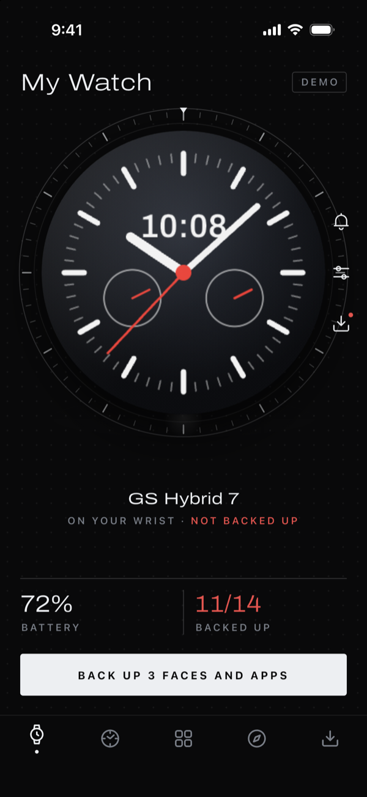
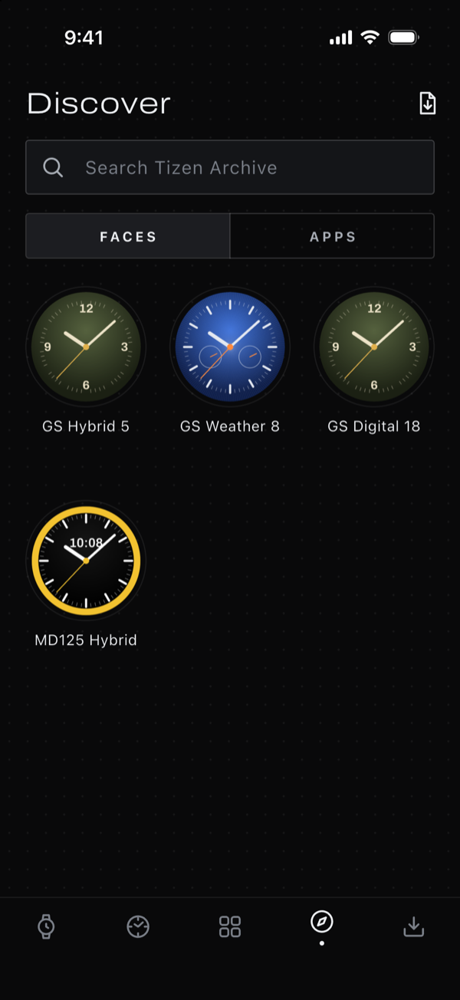
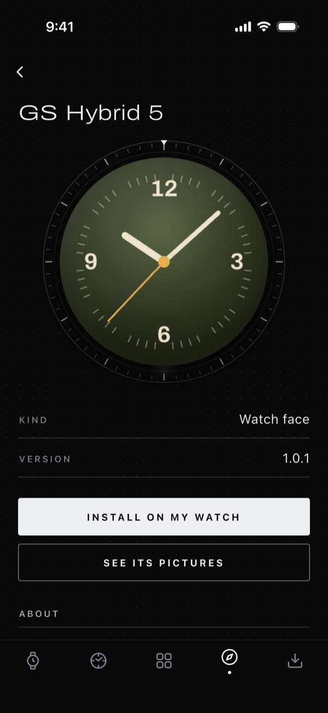
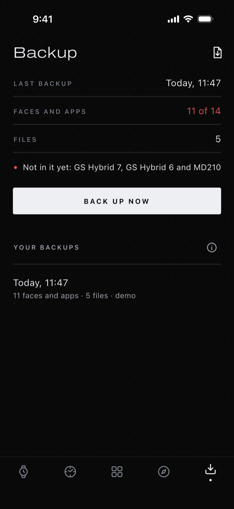
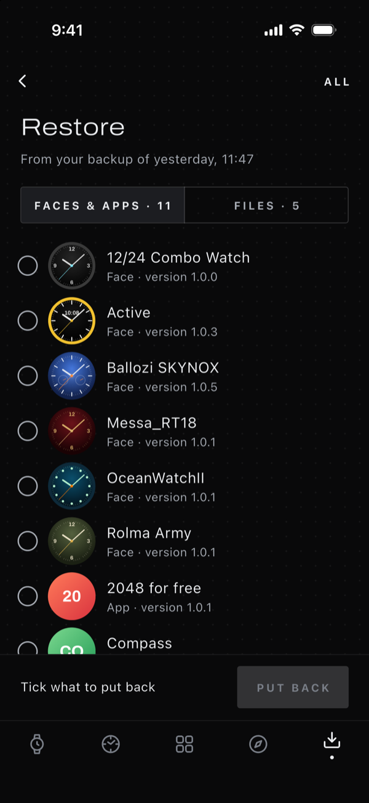
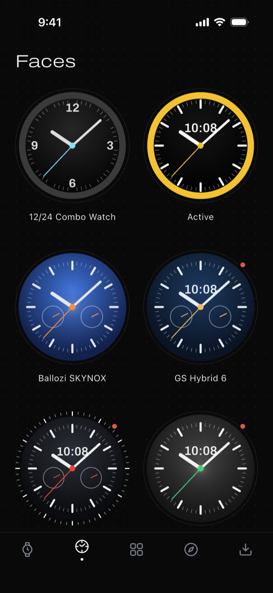
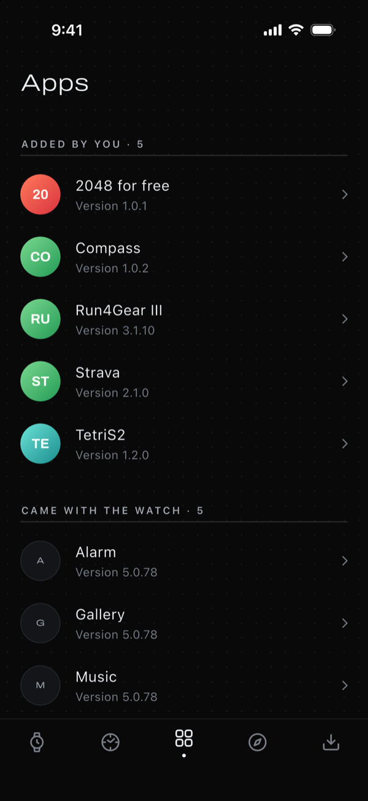
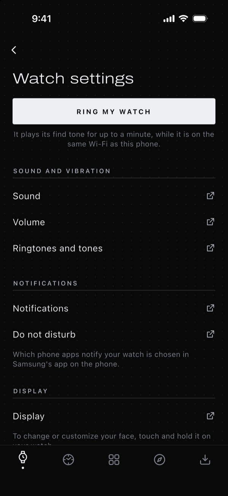

<p align="center">
  
</p>

<h1 align="center">Galaxy Wristore</h1>

<p align="center">
  Install, back up and restore the faces and apps on a Samsung Tizen watch, from your phone or computer, over Wi-Fi.
</p>

<p align="center">
  <a href="https://github.com/Arik39/galaxy-wristore/releases/latest"></a>
  <a href="https://github.com/Arik39/galaxy-wristore/releases"></a>
  <a href="https://github.com/Arik39/galaxy-wristore/actions/workflows/ci.yml"></a>
  <a href="LICENSE"></a>
</p>

<p align="center">
  <a href="#download"><b>Download</b></a>
  &nbsp;·&nbsp;
  <a href="#how-to-use-it">How to use it</a>
  &nbsp;·&nbsp;
  <a href="#build-from-source">Build from source</a>
  &nbsp;·&nbsp;
  <a href="#contributing">Contribute</a>
</p>

<p align="center">
  
  
  
  
</p>

**For Tizen and Galaxy Watch.** Samsung stopped Tizen downloads on 30 September 2025, so the Galaxy Store can no
longer give back a face or an app once a watch is reset. Galaxy Wristore replaces the parts of Samsung's watch app that
went with it. It runs on Android phones and iPhones, and on Windows, Mac and Linux computers.

It talks to the watch directly over its Wi-Fi debugging link (`sdb`), so it needs neither Galaxy Wearable nor an
Android phone.

## Features

**Discover** uses [Tizen Archive](https://tizen-archive.com) in place of the Galaxy Store. Search faces and apps, look
at the pictures inside a package, and install in one tap. Every download is checked against the archive's SHA-256 and
size before it reaches the watch.

**Backup** replaces Samsung account backup. One `.twbackup` file holds copies of the faces and apps you added, the
music and pictures on the watch, and a fingerprint of every app. The app tells you plainly what a reset would remove
for good. It can bring back only the faces and apps that Tizen Archive has: an installed app cannot be copied off the
watch, so one the archive does not have is not in your backup.

**Restore** puts back only what you pick, item by item, with each face's pictures full size.

**Faces and Apps** show what is on the watch with its real pictures, mark what is not backed up, offer updates from
Tizen Archive, and remove what you added.

**Watch controls** ring your watch when you cannot find it, and open the watch's own Sound, Volume, Notifications, Do
not disturb, Display and Quick settings screens, so you can change them on the watch.

**Install a file you have.** Open a `.tpk` or `.wgt` from Discover. The app shows what it is and whether its signature
looks store-signed. The watch has the last word on what it accepts.

**Your backups travel.** Save a backup file anywhere, add it back on another phone or computer, and open backups made
by the [Tizen Companion Installer](https://github.com/Tizen-Archive/tizen-companion-installer) Mac app.

**Private by design.** No account, ads, analytics or trackers.

<p align="center">
  
  
  
  
</p>

<p align="center"><sub>Screenshots from the app's built-in demo watch.</sub></p>

## Download

Get the file for your device from the [latest release](https://github.com/Arik39/galaxy-wristore/releases/latest):

| Your device | Download |
| :--- | :--- |
| Android phone, Android 7.0 or later | [galaxy-wristore-android.apk](https://github.com/Arik39/galaxy-wristore/releases/latest/download/galaxy-wristore-android.apk) |
| Windows PC, Windows 10 or 11 (64-bit) | [galaxy-wristore-windows-x64.zip](https://github.com/Arik39/galaxy-wristore/releases/latest/download/galaxy-wristore-windows-x64.zip) |
| Mac, macOS 12 or later | [galaxy-wristore-macos.dmg](https://github.com/Arik39/galaxy-wristore/releases/latest/download/galaxy-wristore-macos.dmg) |
| Linux PC (64-bit) | [galaxy-wristore-linux-x64.tar.gz](https://github.com/Arik39/galaxy-wristore/releases/latest/download/galaxy-wristore-linux-x64.tar.gz) |
| iPhone | No download yet; [build it yourself](#iphone) |

To hear about new versions, choose **Watch → Custom → Releases** at the top of this page on GitHub.

### Android

1. On your phone, download the APK and open it, from the notification or from **Files → Downloads**.
2. If Android asks, allow your browser or Files app to install unknown apps: tap **Settings**, turn on **Allow from
   this source**, then go back.
3. Tap **Install**. If Google Play Protect says it does not recognise the app, tap **More details**, then **Install
   anyway**. The app is not on Google Play, so Play Protect has not seen it before.
4. Open **Wristore** from your app drawer, then [set up the watch](#set-up-the-watch).

A new version installs over the old one and keeps your backups.

Each release also has `galaxy-wristore-android-arm64.apk`, the same app in a smaller download for 64-bit phones, which
most phones of recent years are. If your phone says it cannot install it, use the main APK. Either one updates the
other.

### Windows

1. Download the zip file, right-click it and choose **Extract All**.
2. Open the **Galaxy Wristore** folder and run `galaxy_wristore.exe`. Keep everything in the folder together; you can
   pin the app to the taskbar once it runs.
3. If Windows says **Windows protected your PC**, click **More info**, then **Run anyway**. Windows says this about
   apps without a paid code signing certificate.

### Mac

1. Open the disk image and drag **Galaxy Wristore** into **Applications**.
2. Open the app. The first time, macOS says it cannot check the app for malware, because it is not notarised by Apple.
   Click **Done**.
3. Open **System Settings → Privacy & Security**, scroll down, and click **Open Anyway** next to Galaxy Wristore. You
   only do this once.
4. When the app asks to find devices on your local network, click **Allow**. It needs that to reach the watch.

### Linux

Extract the archive and run `galaxy_wristore` inside the **galaxy-wristore** folder:

```sh
tar -xzf galaxy-wristore-linux-x64.tar.gz
./galaxy-wristore/galaxy_wristore
```

It needs GTK 3 and a keyring such as GNOME Keyring or KWallet, which most desktops already have. Choosing files needs
`zenity` or `kdialog`.

### iPhone

There is no App Store version yet, so you build it yourself on a Mac:

1. Install [Flutter](https://docs.flutter.dev/get-started/install) (3.47 or later) and Xcode.
2. Get the code and its packages:

   ```sh
   git clone https://github.com/Arik39/galaxy-wristore.git
   cd galaxy-wristore
   flutter pub get
   ```

3. Open `ios/Runner.xcworkspace` in Xcode. Under **Signing & Capabilities**, choose your Personal Team.
4. Connect your iPhone, select it as the run destination, and press **Run**.

Without a paid Apple Developer account, a personal build must be installed again every 7 days. iOS asks for **Local
Network** access the first time the app looks for the watch; the app needs it.

<details>
<summary>Check that a download is genuine</summary>

Each release has a `SHA256SUMS.txt` file listing the SHA-256 checksum of every download. Compare the line for your file
with what your computer reports:

```sh
shasum -a 256 galaxy-wristore-macos.dmg               # Mac and Linux
certutil -hashfile galaxy-wristore-windows-x64.zip SHA256   # Windows
```

Every Android release is signed with the same key. Its certificate's SHA-256 fingerprint is:

```
92:BC:5A:C5:B2:27:72:81:6A:FD:87:65:F1:FA:5E:78:A1:8A:6E:CC:5D:43:CE:D5:36:1E:78:AB:FD:EE:68:F0
```

</details>

## Set up the watch

You do this once per watch.

1. On the watch, open **Settings → About watch → Software**, then tap **Software version** five times.
2. Back in **About watch**, turn on **Debugging**.
3. Restart the watch. Debugging starts answering only after a restart.
4. Keep the watch on the same Wi-Fi as your phone or computer (not a guest network). The first time the app connects,
   the watch asks **Allow debugging**: tap the check mark.

The watch serves one device at a time. Close other tools that connect to it, such as the Mac app or `sdb`, before you
use Galaxy Wristore.

## How to use it

The app has five tabs: **Watch**, **Faces**, **Apps**, **Discover** and **Backup**.

### Connect your watch

1. Wake the watch and keep it awake: tap its screen now and then.
2. On the **Watch** tab, tap **Connect my watch**. The app looks for the watch on your network.
3. Tap your watch in the list. On the watch, tap the check mark to allow this device.

If the watch is not found, tap **Type its address** and enter its IP address. The watch shows it under **Settings →
Connections → Wi-Fi**, then your network.

Once connected, the **Watch** tab shows the face on your wrist, the battery and how much of the watch is backed up. The
app remembers the watch and reconnects next time. If the watch never shows its question, tap **Send the request
again**.

### Find and install faces and apps

1. Open **Discover**. Switch between **Faces** and **Apps**, or search Tizen Archive by name.
2. Tap a face or app to see its details. **See its pictures** shows the pictures inside the package.
3. Tap **Install on my watch**. The app downloads the package, checks it, and installs it on the watch.

### Install a file you have

1. On **Discover**, tap the file icon at the top right.
2. Choose a `.tpk` or `.wgt` file.
3. The app shows its name, version and whether it looks store-signed. Tap **Install on my watch**.

The watch accepts only packages signed for the store, so a rebuilt or changed face is likely to be refused.

### Back up your watch

Open **Backup** and tap **Back up now**, or use the button on the **Watch** tab. Keep the watch awake until the backup
finishes. You can stop a backup that is running; nothing of it is kept.

**Backup** lists what is not in your latest backup yet. On **Faces** and **Apps**, a red dot or **Not backed up** marks
the same, and **Cannot be backed up** marks what Tizen Archive does not have.

Under **Your backups**, tap a backup to restore from it, or tap the arrow beside it for more. **Save or share the
file** (on a computer, **Save a copy**) keeps a copy somewhere else, such as a cloud drive or another device. Do this
before you reset the watch or change phones. **Delete** removes the backup from this device; copies you saved
elsewhere stay.

To use a backup file from elsewhere, tap the file icon at the top right of **Backup** and choose the `.twbackup` file.

### Restore after a reset

1. Set up the watch and connect it again, as above.
2. On **Backup**, tap the backup to restore from.
3. Tick the faces, apps and files to put back, or tap **All**. Tap a face's picture to see it full size.
4. Tap **Put back** and keep the watch awake until it finishes.

### Ring and set up the watch

On the **Watch** tab, tap the bell to make the watch play its find tone for up to a minute; tap it again to stop. The
sliders button opens **Watch settings**, where each row opens that screen on the watch itself, such as Sound,
Display or Do not disturb. The watch does not let other devices change its settings, so you make the change on the
watch. To wear a different face, or to customise one, touch and hold the face on the watch.

### Keep the watch tidy

Open a face on **Faces**, or an app on **Apps**, to see its version, where it came from and whether it is backed up.
From there you can update it when Tizen Archive has a newer version, back it up, or remove it from the watch. Only
faces and apps you added can be removed; the ones that came with the watch stay.

## Troubleshooting

**No watch answered.** Wake the watch, check that **Debugging** is on and that the watch uses the same Wi-Fi as your
phone or computer, then look again. Restart the watch if you have just turned **Debugging** on. Guest networks and some
mesh or office networks keep devices apart; type the address instead.

**Another device is connected to it.** Close the other tool that uses the watch, such as `sdb`, Tizen Studio or the Mac
app, or restart the watch.

**The watch never asks to allow this device.** Wake it and tap **Send the request again**; the question shows on the
watch only while its screen is on.

**iPhone or Mac finds nothing.** Allow Local Network access: on iPhone in **Settings → Privacy & Security → Local
Network**, on a Mac in **System Settings → Privacy & Security → Local Network**.

**The watch refused a package.** The watch installs only store-signed packages, and some are made for specific watch
models.

## What it cannot do

Pairing, notifications from the phone, health sync and software updates run over Samsung's Bluetooth protocols, which
other apps cannot use, so they stay with Samsung's app.

Some limits come from the watch itself. It installs only packages signed for the store, and Samsung no longer issues
developer certificates, so a face that was rebuilt or changed cannot be installed. Installed packages cannot be copied
off a watch, so a backup keeps a copy only of what Tizen Archive has, or of package files you add yourself. The data
inside watch apps, health data included, cannot be read, and the watch does not let other devices change its settings
or choose its face.

## Privacy

There are no ads, analytics or trackers. The app connects only to Tizen Archive and to your watch on your own network.
Backups stay on your device until you save or share them.

## Build from source

The app is written in Flutter (3.47 or later).

```sh
git clone https://github.com/Arik39/galaxy-wristore.git
cd galaxy-wristore
flutter pub get
flutter run                                   # on a connected phone, or on this computer
flutter run --dart-define=WRISTORE_DEMO=true  # with a built-in demo watch, no watch needed
flutter test
```

To build a release, run `flutter build apk --release` for Android, or `flutter build windows`, `flutter build macos`
or `flutter build linux` with `--release` on that kind of computer. An Android build without the project's release key
is signed with your own debug key, so it cannot update an APK from the releases page; uninstall that one first.

## Contributing

Galaxy Wristore is open source, and help is welcome: bug reports, testing with different watch models, fixes and
features. To report a bug or suggest an idea, [open an issue](https://github.com/Arik39/galaxy-wristore/issues/new/choose).

To send a change, fork the repository, make your change on a branch, and open a pull request. Before you do, run
`dart format lib test tool`, `flutter analyze` and `flutter test`, as the checks on every pull request do. The demo
watch is the quickest way to work on the screens. Say how you tested the change, and add before and after screenshots
for anything on screen. For anything large, open an issue first so we can agree on the approach.

If you find a security problem, please do not open a public issue. Report it privately with **Report a
vulnerability** on the repository's **Security** tab.

## Credits and licence

Galaxy Wristore is licensed under the [Apache License 2.0](LICENSE). Contributions are accepted under the same licence.

Its watch connection, package reader, catalog client and backup format are ported from
[Tizen Companion Installer](https://github.com/Tizen-Archive/tizen-companion-installer) by Tizen Archive (Apache
License 2.0). Backups made by its Mac app open here, and the other way round. See [NOTICE](NOTICE).

The Archivo typeface is used under the SIL Open Font License 1.1.

Samsung, Galaxy, Galaxy Watch, Gear and Tizen are trademarks of their respective owners. This project is not
affiliated with or endorsed by Samsung.
